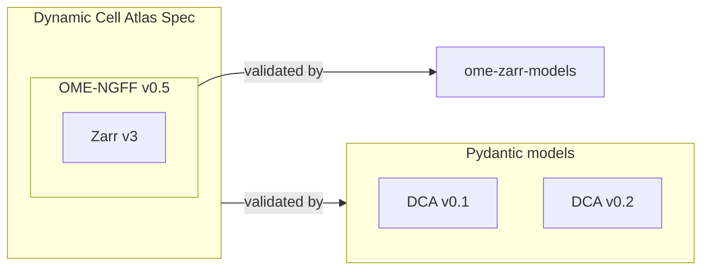

# Validation Module Design

## Overview

This module validates Dynamic Cell Atlas (DCA) Zarr datasets against the DCA specification. Given a local path or an S3 URL, it discovers Zarr stores, validates structure against OME-NGFF v0.5 via [ome-zarr-models](https://github.com/ome-zarr-models/ome-zarr-models-py), then validates DCA-specific requirements via versioned Pydantic models. Each spec version lives in its own package; the generic validator delegates all rule enforcement to whichever model class the registry returns, so adding a version never touches existing code.

Validation produces a report per store:
- **Errors** — MUST violations. The store fails.
- **Warnings** — SHOULD violations. Informational only; the store still passes.



---

## Usage

### CLI

```
dca-validate PATH [OPTIONS]

Options:
  --spec-version TEXT      DCA spec version
  --output [text|json]     Output format [default: text]
  --strict                 Exit 1 if any SHOULD warnings are present
  --show-warnings          Include SHOULD warnings in output (hidden by default)
  --strategy [glob|walk]   S3 discovery strategy [default: glob]
  --check-ontology         Resolve every ontology_term_id against its source
                           registry and check its label. Makes network
                           requests; off by default.
```

`--spec-version` defaults to `CURRENT_SPEC_VERSION` — the installed `dca_helpers` package version truncated to `major.minor` (e.g. `0.2`) — not a hardcoded string; `--help` renders that concrete value, not the symbolic name.

`--strategy` only affects S3 discovery of a parent path: `glob` does one flat `ListObjectsV2` scan (better for many scattered images); `walk` does BFS with early pruning (better for a single/few large plates). Ignored for local paths and for a path that is already a store root.

Exit codes: `0` if all stores pass (warnings allowed unless `--strict`), `1` if any store fails or `--strict` and warnings are present.

#### Ontology lookup (`--check-ontology`)

By default the validator checks only the *pattern* of each `ontology_term_id` (that it is a well-formed CURIE), since the human-readable `label` is carried explicitly on every term so records read without a lookup. Passing `--check-ontology` adds an opt-in pass that resolves each term against the registry its prefix belongs to and compares the stored `label` to that registry's canonical names (case-insensitive, synonyms accepted):

- OBO-library and EFO ontologies (`CL`, `EFO`, `FBbi`, `FBdv`, `HsapDv`, `MmusDv`, `MONDO`, `NCBITaxon`, `PATO`, `UBERON`, `WBls`, `ZFA`, `ZFS`) → [EBI OLS4](https://www.ebi.ac.uk/ols4/). This covers every prefix a v0.2 `ontology_term_id` pattern admits, including the multi-organism anatomy and development-stage ontologies added in v0.2.4; a drift test fails if a later spec version adds one that routes nowhere.
- Cellosaurus cell lines (`CVCL`) → the [Cellosaurus API](https://api.cellosaurus.org/) (OLS does not host Cellosaurus, so a cell-line id would otherwise fail spuriously).
- Any other prefix (gene/compound registries such as `HGNC`, `NCBIGene`, `ensembl`, `PubChem`) is not hosted by a source this pass knows, so it is skipped — not verifiable, not an error.

For fields constrained to a subtree, the term must also descend from a required ancestor (checked via the OLS ancestors endpoint): `preparation_method` must be under `FBbi:00000001` ("sample preparation method") and `imaging_method` under `FBbi:00000222` ("imaging method"). A term from the wrong branch of the right ontology — e.g. a sample-prep term placed in `imaging_method` — is an **error** even when it resolves and its label matches. This is distinct from the offline CURIE-prefix check (which ontology): it enforces which *branch* of that ontology.

When it runs, an id that does not resolve and a label that matches none of the registry's names are **errors**; an unreachable registry is a **warning** (the term is unverified, not invalid) and is also logged, since warnings are hidden in the report unless `--show-warnings` is passed. The `unknown` / `na` / `unavailable` sentinels are not CURIEs and are skipped.

Three things keep a large run from behaving badly against services that are free, key-less and have no published rate limit:

- **Memoization.** One request per unique CURIE, so a term repeated across thousands of stores is fetched once per process.
- **A concurrency ceiling.** `validate` nests thread pools (one over stores, another over an HCS plate's fields) and memoization only collapses *identical* CURIEs, so a cold-cache run over many distinct terms could otherwise put one request per term in flight. At most eight run at a time. The cap covers the request only, so a thread waiting out a backoff is not holding a slot.
- **A negative cache.** Once a registry has exhausted its retries, it is marked unreachable for 30 seconds and further lookups against that host are skipped without a request. Without this, every distinct term pays the full retry budget again, because `functools.lru_cache` stores return values and not exceptions. For 100 distinct terms against a dead registry that is 400 HTTP attempts and roughly 350 seconds of backoff, versus 4 attempts and 3.5 seconds with it. The entry is keyed per host, so an OLS outage does not suppress Cellosaurus; any definite response clears it immediately; and on expiry the next caller simply probes for real, so recovery needs no separate half-open state.

The client identifies itself with a descriptive `User-Agent` and retries transient failures (429 / 5xx / connection errors) up to four times with exponential backoff before recording a warning.

#### Live tests

The unit suite mocks every request, so it cannot notice a registry changing its response shape or renaming a term. `tests/validation/test_ontology_lookup_live.py` calls the real services to cover that, and is skipped unless `--live` is passed:

```bash
pytest tests/validation/test_ontology_lookup_live.py --live -v
```

It checks that each routed prefix still resolves on OLS with the label recorded for it, that the `/terms` and `/ancestors` responses still carry the fields the client reads, that the two hardcoded FBbi subtree ancestors still mean what the constraint assumes, and that Cellosaurus still answers in its own shape. These are meant to run periodically rather than per-commit — CI selects `-m unit` and `-m integration`, so they never run there. A failure is not automatically a bug in this repo: an outage looks the same as a contract change, so read the failure before changing code.

### Python API

```python
from dca_helpers.validation import validate

run = validate("s3://my-bucket/datasets/plate.ome.zarr")   # store root — no discovery
run = validate("s3://my-bucket/datasets/experiment-1/")    # discovers stores under it

print(f"{run.summary.stores_passed}/{run.summary.stores_validated} passed, "
      f"{run.summary.stores_failed} failed, {run.summary.stores_skipped} skipped")

for r in run:   # ValidationRun is iterable over ZarrNodeValidationResult
    if r.skipped:
        continue
    print("PASS" if r.passed else "FAIL", r.node_path)
    for issue in r.issues:
        print(f"  [{issue.severity.name}] {issue.message}")
```

`validate` skips discovery entirely when `path` already has a `zarr.json` at its top level. For large S3 HCS plates with thousands of wells, point at the plate root or a field image directly rather than a parent directory — discovery's prefix scan over thousands of objects can be slow and, on read-only credentials, exhaust the session before completing.

---

## Module Structure

```
helpers/src/dca_helpers/validation/
├── cli.py        # dca-validate entry point
├── discovery.py  # find Zarr store roots (local os.walk; S3 via obstore glob/walk)
├── registry.py   # spec version → DCAStoreSpec / DCALabelStoreSpec model class
├── result.py     # Issue, Severity, ZarrNodeValidationResult, ValidationSummary, ValidationRun
├── runner.py     # validate() — discover + concurrently validate stores under a path
├── validator.py  # validate_zarr_node() — the single generic per-store validator
├── zarr_node.py  # ZarrNodeType enum; classify_group()
└── versions/
    ├── v0_1/models.py                        # DCA v0.1 rules
    └── v0_2/{models.py,experimental_metadata.py}  # DCA v0.2 rules + LinkML-derived metadata
```

Adding a spec version means adding `versions/vX_Y/models.py` and one registry entry — nothing else changes.

---

## Zarr Data Structure Types

Three composable building blocks, each with a different `zarr.json` layout:

**Single image** — one group (`ome.multiscales`) plus one array per pyramid level:
```
image.zarr/
├── zarr.json        ← group, ome.multiscales
├── 0/zarr.json      ← array, full resolution
├── 1/zarr.json      ← array, 2× downsampled
└── 2/zarr.json      ← array, 4× downsampled
```

**Image with labels** — a `labels/` sub-group holds one multiscale image per label type (e.g. segmentation), following the [OME-NGFF image layout](https://ngff.openmicroscopy.org/0.5/#image-layout):
```
image.zarr/
├── zarr.json
├── 0/zarr.json
└── labels/nuclei/{zarr.json, 0/zarr.json, 1/zarr.json}
```

**HCS plate** — `ome.plate` at the root, containing rows → wells → fields, each field a multiscale image that may itself carry `labels/`:
```
plate.ome.zarr/
├── zarr.json                 ← group, ome.plate
└── D/4/
    ├── zarr.json             ← group, ome.well
    └── r04c04f01_0/
        ├── zarr.json         ← group, ome.multiscales (field image)
        ├── 0/zarr.json
        └── labels/nuclei/{zarr.json, 0/zarr.json}
```

### Current coverage

| Structure | NGFF validation | DCA validation |
|---|---|---|
| Single image | Full | Full |
| Image + labels | Image root, plus `labels/` loaded by `open_ome_zarr` | Image pyramid, plus each label declared in `ome.labels` (`IMAGE_LABEL` rows with `parent_path` = the image) |
| HCS plate | Structural checks via raw attrs | Plate structure + per-field image |
| HCS plate + labels | Structural checks via raw attrs | Plate structure + per-field image, plus each selected field's labels (`parent_path` = the field) |

Label groups are reached from `validate_zarr_node`, not from discovery: discovery still returns only outermost store roots, so no label store is validated twice. `_validate_labels_of` reads `<image>/labels`, validates each name in `ome.labels` once, and never looks for a label's own `labels/`. Details:

- Each label listed in `ome.labels` is checked against the same rules as `ome-zarr-models` (missing group, non-integer dtype, level-count mismatch). These defects fail the parent with `ngff_validation` and skip its DCA checks, because ome-zarr-models loads `labels/` when it opens the image. The label rows still carry the DCA findings.
- DCA adds three checks. A listed group without `ome.image-label` is an error. An empty name, a name with a path separator, or `..` is an error. Groups under `labels/` that `ome.labels` does not list give one WARNING row (`LABELS_LIST`). Duplicate names are validated once. A missing `labels/` group is not an error.
- `--wells`, `--field-offset` and `--field-limit` apply to labels: only the labels of selected fields are validated.
- A store whose only defect is in a label has a passing root row, as with HCS fields. Query child rows by `parent_path`.
- **No v0.1 label model.** v0.1 has no registered label model — `get_label_model` raises `UnsupportedSpecVersionError`, which becomes `passed=True` with a WARNING per label. v0.2 registers `DCALabelStoreSpecV0_2`.
---

## Validation Pipeline

`validate_zarr_node(node_path, spec_version, ModelClass)` runs both NGFF structural validation and DCA validation for one store, dispatching by what's actually in the store's raw attrs — never by assuming a type up front, because trusting `ome-zarr-models`' own dispatch would mean opening every well/field before validation could even ambiguity-check the input (see step 3).

1. **Open + read raw attrs.** `open_zarr_group(node_path)` opens the group (using `obstore` for `s3://` paths — see [S3 I/O](#s3-io-optimization)); `raw_attrs = dict(zarr_group.attrs)`, then `raw_ome_attrs = raw_attrs.get("ome", {})` and `raw_dca_attrs = raw_attrs.get("dca")`. Failure here → `loc=("s3_io",)` (network/auth) or `loc=("store_open",)` (unreadable/missing `zarr.json`); everything downstream is skipped.
2. **GEFF skip.** If `"geff"` is a top-level attrs key, the store is a GEFF tracking store — not OME-Zarr at all — and returns `skipped=True, node_type=GEFF` immediately, before any `ome.*` key is interpreted.
3. **HCS fast path.** If `raw_ome_attrs` has `"plate"` but not `"multiscales"`, plate validation runs directly against the raw dict (`_validate_hcs_plate`), and `open_ome_zarr()`/`classify_group()` are **not called**. This is deliberate: `ome-zarr-models`' typed `HCS.from_zarr()` recursively opens every well via `Well.from_zarr()`, which recursively opens every field via `Image.from_zarr()` — O(N_fields) sequential S3 reads before a single check has run, for a hierarchy that OME-NGFF itself defines as strictly nested (plate → well → field). The fast path instead does one open per hierarchy level: `_check_plate_schema` reads rows/columns/acquisitions/wells straight from the dict; `_gather_plate_fields` opens each declared **well** once to see which fields exist on disk; each **field** is then opened and validated independently and concurrently via `ThreadPoolExecutor`, since OME-NGFF's containment model guarantees fields don't depend on each other.
4. **NGFF structural validation** (non-plate types only) — `open_ome_zarr(zarr_group)`. This is pure delegation to `ome-zarr-models`: it tries each known OME-NGFF group model and returns the first that matches the group's `zarr.json`, raising if none does (→ `loc=("ngff_validation",)`, DCA validation skipped). Because the root here *is* the image group (no recursive containment for non-plate types), this is cheap and gives typed access to `ome.multiscales`.
5. **Classify.** `classify_group()` maps the typed return value to a `ZarrNodeType`, but first re-checks `raw_ome_attrs` for `"plate"` + `"multiscales"` both present and raises `ValueError` if so. This check exists because `ome-zarr-models`' base attrs model uses `extra="allow"` — it would otherwise silently accept a malformed dual-typed group as HCS and discard the multiscales data. `raw_ome_attrs` must be the dict captured *before* `open_ome_zarr` ran, not derived from its typed object, or the ambiguity would already be resolved (and hidden) by the time it's checked.
6. **Dispatch by `ZarrNodeType`** (see table below).

### `ZarrNodeType`

Five structurally distinct `zarr.json` schemas. `IMAGE` and `IMAGE_LABEL` share the same `ome.multiscales` shape — an `ImageLabel` is just a multiscales image that additionally carries `ome.image-label` (a lookup table from label integer to color/name) — so both go through the same `_build_node_dict`/`_validate_image` extraction, differing only in which model class is applied and whether `dca` channel metadata is injected.

| `ZarrNodeType` | `zarr.json` key | Handling |
|---|---|---|
| `IMAGE` | `ome.multiscales` | `_build_node_dict` → registered `DCAStoreSpec.model_validate`, with raw `dca` attrs injected |
| `IMAGE_LABEL` | `ome.multiscales` + `ome.image-label` | Same extraction, `dca=None`; uses `get_label_model(spec_version)` if registered (v0.2), else `passed=True` + WARNING (v0.1) |
| `HCS_PLATE` | `ome.plate` | Reached via the Step 3 fast path — never via `classify_group` |
| `LABELS_LIST` | `ome.labels` | Container listing label names, no arrays — the container passes, and each declared label is validated as `IMAGE_LABEL` |
| `GEFF` | `geff` (root, no `ome` key) | Reached via the Step 2 fast path — `skipped=True`, not validated |

### DCA checks by node type (v0.1)

| Check | Severity | Image group | Scale-level array | HCS plate root | Label image group (v0.1) |
|---|---|---|---|---|---|
| Axes == [t,c,z,y,x] | MUST | ✓ | — | — | ✗ not checked |
| ≥ 3 scale levels | MUST | ✓ | — | — | ✗ not checked |
| t/c not downsampled across levels | MUST | ✓ (array shapes) | — | — | ✗ not checked |
| Spatial downsampling ≈ 2 | SHOULD | ✓ (array shapes) | — | — | ✗ not checked |
| Codec in {zstd, lz4, blosc} | MUST | — | ✓ | — | ✗ not checked |
| Chunk ≥ 512 KB / ≥ 1 MB | MUST / SHOULD | — | ✓ (level 0 only) | — | ✗ not checked |
| Chunk shape t=1,c=1,z=y=x=128 | SHOULD | — | ✓ | — | ✗ not checked |
| Shard < 5 TB; ≥ 1 GB when array ≥ 1 GB | MUST | — | ✓ | — | ✗ not checked |
| Shard < 5 GB; spatial ≤ 2048; time ≥ 16 | SHOULD | — | ✓ | — | ✗ not checked |
| Compression level ≤ 3 | SHOULD | — | ✓ | — | ✗ not checked |
| dtype uint8/uint16 (raw) or uint32 (label) | SHOULD | — | ✓ | — | ✗ not checked |
| **Overall** | | **Fully validated** | **Fully validated** | **WARNING only** (see below) | **Skipped** (no v0.1 label model) |

All array-level checks are self-contained within one array's `zarr.json`; the group-level downsampling checks need array shapes across levels, so they span both node types. The min-chunk-size checks (512 KB MUST / 1 MB SHOULD) apply only at `level_index == 0` — chunk size is expected to shrink at coarser levels, so they're exempt. v0.2 (below) fully validates label image groups via `DCALabelStoreSpecV0_2`.

### HCS plate root checks

The plate root's `ome.plate` is a manifest of wells/rows/columns/acquisitions — cross-referencing it against what's actually on disk is inherently a "does the manifest match reality" check, not something derivable from any single field's `zarr.json`. `_check_plate_schema` covers pure-metadata rules (row/column names alphanumeric + unique, `fieldCount` positive, acquisition `id` present and a non-negative unique integer, well paths well-formed and referencing declared rows/columns). `_gather_plate_fields` covers rules requiring an on-disk look (missing declared well/field, orphan field not declared in `ome.well.images`, field acquisition ID cross-referenced against `ome.plate.acquisitions`) and also collects axes/chunk-shape per field so `_validate_hcs_plate` can flag non-uniformity across fields (SHOULD). One gap: `plate.version` presence is not checked at all.

---

## Discovery

`discovery.py` treats a directory as a store root if it has a top-level `zarr.json`.

- **Local**: `os.walk`, calling `dirnames.clear()` once a root is found so it never descends into that store's sub-groups (scale-level arrays, `labels/`, wells).
- **S3**: `glob` (paginated flat prefix scan, filtered to outermost roots) or `walk` (BFS via `list_with_delimiter`, pruning descent at each root) — see `--strategy` above.

Consequence: discovery does not find label groups. `validate_zarr_node` validates them from the store root it receives (see Current coverage above).

---

## Registry

`registry.py` holds two dicts and two lookups:

```python
_REGISTRY       = {"0.1": DCAStoreSpecV0_1, "0.2": DCAStoreSpecV0_2}
_LABEL_REGISTRY = {"0.2": DCALabelStoreSpecV0_2}

def get_model(spec_version): ...        # raises UnsupportedSpecVersionError if unknown
def get_label_model(spec_version): ...  # same, with label=True for a label-specific message
```

New spec version → new `versions/vX_Y/models.py` + one entry in each dict. Existing entries never change.

---

## Pydantic Models — v0.1

`versions/v0_1/models.py` — `model_config = ConfigDict(extra="allow")` throughout, so unrecognized future keys don't fail older models. MUST violations raise `ValueError` unprefixed; SHOULD violations prefix `[SHOULD]`, converted to `Severity.WARNING` by `_convert_errors`.

**`DCAScaleLevelSpec`** (one Zarr array): `path, dtype, shape, chunk_shape, shard_shape, codec_id, codec_level`. Enforces the array-level rows of the table above via `field_validator("codec_id")` and one `model_validator`, `check_array_rules`, which collects the messages from the chunk-size, channel-chunk, shard-size, compression and dtype rules and raises once.

> **Validator ordering caveat**: Pydantic v2 stops a model's `mode="after"` validator chain at the first raise. The level spec and the v0.2 store models therefore use one collecting validator each (`check_array_rules`, `check_store_rules`), so the rules in that chain never hide each other. The v0.1 store has a single after-validator, `check_downsampling_factors`. Two gaps remain. A failed field-level validator (for example `axes`, a missing `dca`, or the v0.1 level count) skips the model's after-validators. A failed nested model (for example a level with a chunk-size SHOULD, a bad `dimension_names`, or a channel missing a required field) skips the parent's after-validators. In both cases the store-level rules do not run. This applies throughout v0.1 and v0.2.

**`DCAStoreSpecV0_1`** (root model, entry point for `model_validate()`): `spec_version, axes, multiscale_level_count, levels`. Enforces the group-level rows via `axes_must_be_tczyx`, `must_have_minimum_scales`, `check_downsampling_factors`.

---

## Pydantic Models — v0.2

Adds channel metadata and `dca`-block validation; replaces the minimum-scale-count rule with a coarsest-level spatial-dimension cap; adds `dimension_names`/`axis_units` checks.

| Rule | Severity | vs. v0.1 |
|---|---|---|
| Axes == [t,c,z,y,x] | MUST | inherited |
| All spatial dims of coarsest level ≤ 2048 | MUST | **replaces** ≥3 scale levels |
| t/c not downsampled; spatial ≈2 | MUST/SHOULD | inherited |
| `dimension_names` present and matches axes | MUST | new — read from the array's `zarr.json`, not the group |
| `axis_units` present and in the OME-NGFF vocabulary per axis | MUST | new |
| `t` unit absent, with `acquisition.time_sampling = "variable"` declared | SHOULD | new — the MUST above is relaxed only for a declared variable-rate acquisition |
| `acquisition.timestamps` present when sampling is `variable`, one per timepoint, non-decreasing | MUST | new — what makes the relaxation checkable |
| Level-0 `t` scale is 1 when sampling is `variable` | MUST | new |
| `dca` key present | MUST | new |
| Channel count matches C axis size | SHOULD | new |
| `normalization_statistics[*].timepoint_statistics`, when present, has keys exactly `"0"` to `"T-1"` as strings (T read from the level-0 shape) | MUST | new |

**`DCAGroupMetadataV0_2`** (the `dca` root object): `version: Literal["0.2"], url, channels: list[DCAChannelMetadataV0_2], normalization_statistics`. Channel `index` values must be unique. Each channel carries `channel_type` (SHOULD be in `{fluorescence, labelfree, predicted}`, and SHOULD have `biological_annotation` when fluorescence/predicted) and an optional `biological_annotation.marker_type` (SHOULD be in a fixed vocabulary).

**Known gaps**: `dca.url` is required but its format is never checked (spec says it MUST point to the GitHub spec repo; any string passes).

**Experimental metadata** (`dca.study`/`dca.biosample`/`dca.provenance`/etc.) is validated separately by `versions/v0_2/experimental_metadata.py` against a LinkML-generated model, enforcing conditional rules (e.g. `source_kind: agent ⇒ citation` required) that `gen-pydantic` records but doesn't itself enforce, plus a provenance-coverage check with no LinkML equivalent. See that module's docstring for why each piece is structured the way it is — it's a self-contained sub-design, not part of the core array/channel pipeline described here.

**`DCALabelStoreSpecV0_2`** — standalone root model for `IMAGE_LABEL` nodes. No `dca` field (label groups carry no channel metadata); otherwise identical MUST/SHOULD rules to `DCAStoreSpecV0_2`. Its `DCALabelScaleLevelSpecV0_2` overrides only the dtype recommendation, through the `_dtype_messages` hook: SHOULD warn unless dtype is `uint32` (vs. v0.1's `{uint8, uint16, uint32}`). The validator-ordering caveat above applies.

---

## Result Types

```python
class Severity(str, Enum):
    ERROR = "error"      # MUST violation
    WARNING = "warning"  # SHOULD violation

@dataclass
class Issue:
    loc: tuple[int | str, ...]
    message: str
    severity: Severity

@dataclass
class ZarrNodeValidationResult:
    node_path: str
    spec_version: str | None
    passed: bool
    parent_path: str | None = None            # plate root, for HCS field results
    ngff_version: str | None = None
    multiscale_level_count: int | None = None
    issues: list[Issue] = field(default_factory=list)
    node_type: ZarrNodeType | None = None
    skipped: bool = False                      # intentionally not validated (e.g. GEFF)

    @property
    def errors(self) -> list[Issue]: ...        # issues filtered to ERROR
    @property
    def warnings(self) -> list[Issue]: ...       # issues filtered to WARNING

@dataclass
class ValidationSummary:
    stores_validated: int             # non-skipped; == stores_passed + stores_failed
    level_zarr_jsons_validated: int   # non-skipped only
    stores_passed: int
    stores_failed: int
    stores_skipped: int               # e.g. GEFF
    stores_discovered: int
    duration_seconds: float
    nodes_by_type: dict[ZarrNodeType, int]   # includes skipped types

@dataclass
class ValidationRun:
    path: str
    results: list[ZarrNodeValidationResult]
    summary: ValidationSummary
    # __iter__ over results, __len__ == len(results)
```

`passed` is `True` iff `issues` has no `ERROR`. Warnings never flip it.

---

## Runner

`runner.py`'s `validate()` resolves `path` to a store list (`is_zarr_store` → skip discovery, else `discover_zarr_stores(path, strategy)`), then validates all of them **concurrently** via `ThreadPoolExecutor` — either through `_validate_plain` (headless) or `_validate_with_tree` (a `rich.Live` tree showing in-flight stores, used by default for `--output text`). `spec_version` defaults to `CURRENT_SPEC_VERSION` (the installed package version truncated to `major.minor`) rather than a hardcoded string — there is no `dca.spec_version` attribute in `zarr.json`; the caller always supplies the version being validated against.

---

## S3 I/O Optimization

The validator uses [obstore](https://github.com/developmentseed/obstore) instead of fsspec/s3fs for S3 access, because of GIL behavior: fsspec/s3fs routes reads through boto3 + urllib3, both of which hold the GIL during request signing and HTTP parsing, so `ThreadPoolExecutor` workers doing S3 I/O effectively take turns despite looking concurrent. obstore wraps the Rust `object_store` crate via PyO3 and releases the GIL at the Rust boundary, so the full HTTP round-trip runs GIL-free and threads run truly in parallel — which matters here because both HCS field validation and multi-store `runner.py` validation are structured as one-thread-per-independent-unit.

`open_zarr_group(path)`, defined in `discovery.py` and imported by `validator.py`, is the single dispatch point: `s3://` paths get a `zarr.storage.ObjectStore` backed by obstore; local paths are unchanged. `discovery.py` similarly uses `obstore.list`/`list_with_delimiter`/`head` in place of s3fs's `glob`/`walk`/`exists`.

Network/infra failures (throttling, auth, connectivity) are caught as `obstore.exceptions.BaseError` and reported at `loc=("s3_io",)` — distinct from structural failures (`loc=("store_open",)`, `loc=("ngff_validation",)`) so it's unambiguous whether a failure is a data-quality issue or a transient access problem.

---

## Backwards Compatibility

Each DCA spec **minor** version is isolated in its own package: adding `versions/v0_X/models.py` + a registry entry has no impact on existing versions. `validator.py` changes affect all versions — reserved for store-parsing bug fixes, never for spec-rule changes.

Within a released minor version, rules may be **relaxed** in a patch release. Widening an accepted ontology set, or adding a permissible enum value, still accepts everything the previous patch accepted, so metadata that validated before continues to validate. Rules are never **narrowed** in place: any change that would reject previously valid metadata requires a new minor version with its own `docs/vX.Y` and `versions/vX_Y` package.

The version lives in `CURRENT_VERSION` (SemVer); `pyproject.toml` and the release tag both derive from it. The model registry is keyed by minor version, so all `0.2.*` releases resolve to `docs/v0.2` and `versions/v0_2`. Only a minor bump adds folders.

---

## Dependencies

| Package | Purpose |
|---|---|
| `pydantic >= 2.0` | Model validation |
| `ome-zarr-models >= 1.0` | OME-NGFF v0.5 structural validation and typed metadata |
| `pydantic-zarr` | `ArraySpec` — typed codec/chunk/shard metadata |
| `zarr >= 3.0` | Open Zarr stores, read `zarr.json` |
| `obstore >= 0.9` | GIL-free S3 I/O backend |
| `click >= 8` | `dca-validate` CLI |
