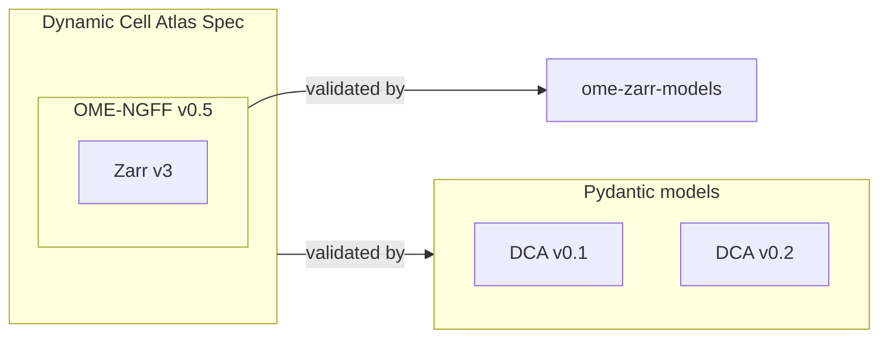

# Validation Module Design

## Overview

This document describes the design for a Python validation module that validates Dynamic Cell Atlas (DCA) Zarr datasets against the DCA specification. Given a local filesystem path or an S3 URL, the module discovers all Zarr stores recursively, validates each against OME NGFF v0.5 using [ome-zarr-models](https://github.com/ome-zarr-models/ome-zarr-models-py), and then validates DCA-specific requirements using Pydantic models. Multiple DCA spec versions are supported without modifying existing validator code — each spec version lives in its own package, and the generic validator delegates all rule enforcement to whichever model class the registry returns.

Validation produces a report per store containing:
- **Errors** for violations of MUST requirements — the store fails validation.
- **Warnings** for violations of SHOULD requirements — informational only, the store still passes.



---

## Usage

### Install

```bash
uv pip install -e .
```

### CLI

```
dca-validate PATH [OPTIONS]

Arguments:
  PATH  Local path or s3://bucket/prefix URL. If PATH contains zarr.json at
        its top level, validates that store directly. Otherwise discovers and
        validates all Zarr stores found under PATH.

Options:
  --spec-version TEXT     DCA spec version to validate against [default: 0.1]
  --output [text|json]    Output format [default: text]
  --strict                Exit 1 if any SHOULD warnings are present
  --help                  Show this message and exit.
```

```bash
dca-validate path/to/dataset/
dca-validate s3://my-bucket/data/plate.ome.zarr --output json
dca-validate path/to/dataset/ --strict
```

Exit codes: `0` if all stores pass (warnings allowed unless `--strict`), `1` if any store fails or `--strict` and warnings present.

### Python API

`validate` accepts any path in the hierarchy — a single store, a subdirectory, or an ancestor containing multiple stores. The spec version defaults to `"0.1"` and is caller-supplied, not read from the store.

```python
from dca_helpers.validation import validate

# Single store (no discovery — fast):
run = validate("s3://my-bucket/datasets/plate.ome.zarr")

# Subdirectory within a dataset (discovers all stores under it):
run = validate("s3://my-bucket/datasets/experiment-1/")

# Ancestor containing multiple stores:
run = validate("s3://my-bucket/datasets/")

print(f"{run.summary.stores_passed}/{run.summary.stores_validated} passed, {run.summary.stores_failed} failed")
print(f"  discovered={run.summary.stores_discovered}, duration={run.summary.duration_seconds:.1f}s")

for r in run:   # ValidationRun is iterable over its results
    status = "PASS" if r.passed else "FAIL"
    print(f"{status} {r.node_path}")
    for issue in r.issues:
        print(f"  [{issue.severity.name}] {issue.message}")
```

If the path has a `zarr.json` at its top level, `validate` validates it directly without any recursive discovery. Otherwise it walks the path and validates every Zarr store root found within it.

For large S3 HCS plates with thousands of wells, point `validate` at the plate root or an individual field image directly rather than a parent directory. The recursive discovery glob over thousands of S3 objects can exhaust session credentials before completing. Note that validating a plate root will run HCS structural checks (e.g. verifying all declared wells exist as Zarr groups) in addition to per-field DCA checks.

### Interpreting results

`r.passed` is `True` when there are no `ERROR`-severity issues. `WARNING`-severity issues (SHOULD violations) never cause a store to fail.

```python
from dca_helpers.validation.result import Severity

for r in run:
    errors   = [i for i in r.issues if i.severity == Severity.ERROR]
    warnings = [i for i in r.issues if i.severity == Severity.WARNING]
    print(f"{r.node_path}: {len(errors)} errors, {len(warnings)} warnings")
```

### S3 access

Pass AWS credentials via environment or profile before calling:

```python
import os
os.environ["AWS_PROFILE"] = "my-profile"

from dca_helpers.validation import validate
run = validate("s3://my-bucket/data/image.zarr")
```

---

## Module Structure

```
helpers/src/dca_helpers/validation/
├── __init__.py
├── cli.py                # CLI entry point (dca-validate)
├── discovery.py          # Recursively find Zarr stores (local + S3)
├── registry.py           # Maps DCA spec versions to their DCAStoreSpec model class
├── result.py             # ZarrNodeValidationResult, Issue, Severity, ValidationSummary
├── runner.py             # validate — discover and validate stores under a path
├── validator.py          # validate_zarr_node — single generic validator
├── zarr_node.py          # ZarrNodeType enum; classify_group()
└── versions/
    ├── __init__.py
    ├── v0_1/
    │   ├── __init__.py
    │   └── models.py     # Pydantic models for DCA v0.1; field validators ARE the spec rules
    └── v0_2/
        ├── __init__.py
        └── models.py     # Pydantic models for DCA v0.2; inherits v0.1 array rules, adds channel metadata
```

Each spec version only needs a `models.py`. Adding a new DCA spec version means adding a new `versions/vX_Y/` package with its own `models.py` and a single registry entry — no other files change.

---

## Zarr Data Structure Types

The DCA spec covers three structural building blocks, each with a different `zarr.json` layout. These blocks are **composable**: an HCS plate contains multiscale images, and those images may each carry label arrays. The validator must handle all three and their combinations.

### Single Image

A single OME-NGFF multiscale image — one Zarr group with `ome.multiscales` containing one or more pyramid levels. This is the base case: one root `zarr.json` plus one `zarr.json` per scale level.

```
image.zarr/
├── zarr.json        ← group, ome.multiscales
├── 0/zarr.json      ← array, full resolution
├── 1/zarr.json      ← array, 2× downsampled
└── 2/zarr.json      ← array, 4× downsampled
```

The DCA spec requires at least 3 spatial scales (MUST) and 5D TCZYX axes.

### Multiscale Image with Labels

A single image group that additionally carries one or more label arrays (e.g. segmentation masks) under a `labels/` sub-group, following the [OME-NGFF image layout](https://ngff.openmicroscopy.org/0.5/#image-layout).

```
image.zarr/
├── zarr.json              ← group, ome.multiscales
├── 0/zarr.json            ← array
├── labels/
│   └── nuclei/
│       ├── zarr.json      ← group, ome.multiscales (label image)
│       ├── 0/zarr.json    ← array
│       └── 1/zarr.json    ← array
```

Labels are discovered as nested groups within the same store root. They share the same chunk/shard/compression requirements as raw image arrays. Discovery treats the outer image root as the single store; label arrays are validated as part of that store, not as independent stores.

### HCS Plates

A plate group with `ome.plate` at the root, containing rows → wells → fields, each field being a multiscale image. The DCA spec says data SHOULD follow [OME-NGFF 0.5 plate and well metadata](https://ngff.openmicroscopy.org/0.5/#plate-md).

Fields within an HCS plate may themselves carry `labels/` sub-groups, making the full combination: **HCS plate → multiscale image → labels**. Each well field has both a raw image pyramid and a `labels/<label_type>/` label image.

```
plate.ome.zarr/
├── zarr.json                        ← group, ome.plate
└── D/
    └── 4/
        ├── zarr.json                ← group, ome.well
        └── r04c04f01_0/
            ├── zarr.json            ← group, ome.multiscales (field image)
            ├── 0/zarr.json          ← array
            ├── 1/zarr.json          ← array
            └── labels/
                └── nuclei/
                    ├── zarr.json    ← group, ome.multiscales (label image)
                    ├── 0/zarr.json  ← array
                    └── 1/zarr.json  ← array
```

### Current Validation Coverage

| Structure | NGFF validation | DCA Pydantic models |
|---|---|---|
| Single image | Full (`open_ome_zarr`) | Full (`DCAStoreSpecV0_1`) |
| Multiscale image with labels | Full (image root only) | Image pyramid only — label groups not validated |
| HCS plate | Structural checks via raw zarr attrs (`_gather_plate_fields`) | Plate structural checks + per-field `DCAStoreSpecV0_1` |
| HCS plate + labels | Structural checks via raw zarr attrs | Plate structural + per-field image — field label groups not validated |

**Label group gaps**: there are two distinct issues affecting label array validation.

**Gap 1 — Discovery**: `discovery.py` stops at the outermost `zarr.json` and does not descend into sub-groups (`dirnames.clear()` in local walk; ancestor filter in S3). A `labels/segmentation/` group has its own `zarr.json` but is never returned by `discover_zarr_stores` and never passed to `validate_zarr_node`. Label arrays are invisible to the runner unless the caller points directly at the label group path.

**Gap 2 — No label DCA model (resolved for v0.2)**: If `validate_zarr_node` is called directly on a label group path (e.g. `labels/segmentation/`), `classify_group` correctly returns `ZarrNodeType.IMAGE_LABEL` and `validate_zarr_node` dispatches to the `IMAGE_LABEL` branch. For spec versions with no registered label model (currently v0.1), `validate_zarr_node` catches `UnsupportedSpecVersionError` and returns `passed=True` with a `WARNING` rather than applying the wrong image model. `DCALabelStoreSpecV0_2` is registered for v0.2 — label groups are fully validated when addressed directly.

---

## DCA Spec Checks by zarr.json Node Type

Each zarr.json in a store has one of four distinct schemas. The table below maps every DCA v0.1 check to the node type it is read from, and whether it is currently implemented.

| DCA v0.1 Check | Severity | Image group (`multiscales`) | Scale level array | HCS plate (`plate`) | Labels container (`labels`) | Label image group (`multiscales`) |
|---|---|---|---|---|---|---|
| **Checks read from the group node** | | | | | | |
| Axes == [t,c,z,y,x] | MUST | ✓ | — | — | — | ✗ not checked |
| ≥ 3 scale levels | MUST | ✓ | — | — | — | ✗ not checked |
| t/c not downsampled across levels | MUST | ✓ (uses array shapes) | — | — | — | ✗ not checked |
| Spatial downsampling ≈ 2 | SHOULD | ✓ (uses array shapes) | — | — | — | ✗ not checked |
| **Checks read from the array node** | | | | | | |
| Codec in {zstd, lz4, blosc} | MUST | — | ✓ | — | — | ✗ not checked |
| Chunk ≥ 512 KB | MUST | — | ✓ | — | — | ✗ not checked |
| Chunk ≥ 1 MB | SHOULD | — | ✓ | — | — | ✗ not checked |
| Chunk shape t=1, c=1, z=y=x=128 | SHOULD | — | ✓ | — | — | ✗ not checked |
| Shard < 5 TB | MUST | — | ✓ | — | — | ✗ not checked |
| Shard ≥ 1 GB when array ≥ 1 GB | MUST | — | ✓ | — | — | ✗ not checked |
| Shard < 5 GB | SHOULD | — | ✓ | — | — | ✗ not checked |
| Spatial shard dims ≤ 2048 | SHOULD | — | ✓ | — | — | ✗ not checked |
| Time shard dim ≥ 16 | SHOULD | — | ✓ | — | — | ✗ not checked |
| Compression level ≤ 3 | SHOULD | — | ✓ | — | — | ✗ not checked |
| dtype uint8/uint16 or uint32 | SHOULD | — | ✓ | — | — | ✗ not checked |
| **Overall** | | **Fully validated** | **Fully validated** | **WARNING only** | **Skipped** | **Skipped** |

All array-level DCA checks are self-contained within each array's zarr.json. The four group-level checks are logically read from the image group's zarr.json but require array shapes across levels to evaluate downsampling, so they span both node types in practice.

### ZarrNodeType and ome-zarr-models Type Mapping

`zarr_node.py` defines four `ZarrNodeType` values. For non-HCS stores, `classify_group()` maps the object returned by `open_ome_zarr()` to one of these values and enforces a constraint that ome-zarr-models does not: mutual exclusivity between `ome.plate` and `ome.multiscales`. Because `ome-zarr-models` uses `extra="allow"` on its base attrs model, a malformed group carrying both keys would be silently accepted as `HCS`, discarding the multiscales data. `classify_group()` reads `raw_ome_attrs` (the raw `zarr.group.attrs["ome"]` dict captured before `open_ome_zarr` was called) and raises `ValueError` on ambiguity before the ome-zarr-models type is trusted. HCS plates are detected from `raw_ome_attrs` directly and return early before `open_ome_zarr` or `classify_group` are called.

| `ZarrNodeType` | ome-zarr-models type | `zarr.json` key | How `validate_zarr_node` handles it |
|---|---|---|---|
| `IMAGE` | `Image` | `ome.multiscales` | `_build_node_dict` → `ModelClass.model_validate` |
| `IMAGE_LABEL` | `ImageLabel` | `ome.multiscales` + `ome.image-label` | `get_label_model(spec_version)` → `_validate_image(LabelModelClass, dca=None)`; falls back to `passed=True` with WARNING for versions with no registered label model (v0.1) |
| `HCS_PLATE` | *(bypassed — raw zarr attrs)* | `ome.plate` | `_gather_plate_fields` (raw zarr attrs, sequential per-well) + concurrent `_validate_field` via `ThreadPoolExecutor` |
| `LABELS_LIST` | `Labels` | `ome.labels` | Returned as `passed=True` immediately — no arrays to validate |

`IMAGE` and `IMAGE_LABEL` share an identical `ome.multiscales` zarr.json schema, so `_build_node_dict` works correctly for both. `validate_zarr_node` dispatches them to separate branches: `IMAGE` uses the registered `DCAStoreSpec` model with the raw `dca` attrs injected; `IMAGE_LABEL` looks up `_LABEL_REGISTRY` and passes `dca=None` (label groups carry no channel metadata). For v0.1, `_LABEL_REGISTRY` has no entry and the label branch returns a WARNING; for v0.2, `DCALabelStoreSpecV0_2` is registered and full DCA validation runs.

### HCS plate checks and the root zarr.json

For single image stores the root is also the image group, so all checks are self-contained. For HCS plates the root carries `ome.plate` — a manifest of wells, rows, columns, and acquisitions. The following table summarises which checks require the plate root and their implementation status:

| Check | Needs root | Currently implemented |
|---|---|---|
| Chunk size, codec, shard, dtype per level | No | Yes |
| Axes, level count, downsampling per field | No (self-contained) | Yes |
| Missing well declared in `ome.plate.wells` | Yes | Yes |
| Missing field declared in `ome.well.images` | Yes | Yes |
| Acquisition ID references valid | Yes | Yes (`_gather_plate_fields`) |
| Cross-field consistency (axes, chunk shape uniform) | Yes | Yes |
| `plate.fieldCount` is a positive integer (if present) | Yes | Yes (`_check_plate_schema`) |
| Row/column names alphanumeric and unique | Yes | Yes (`_check_plate_schema`) |
| Well paths reference declared rows and columns | Yes | Yes (`_check_plate_schema`) |
| Acquisition `id` is a non-negative integer | Yes | Yes (`_check_plate_schema`) |
| Acquisition entry is missing `id` key entirely | Yes | Yes (`_check_plate_schema`) |
| Plate `version` field present | Yes | No (SHOULD-level warning only) |
| Orphan field on disk not declared in well | Yes | Yes (`_gather_plate_fields`) |
| Field declared in `ome.well.images` but absent on disk | Yes | Yes (`_gather_plate_fields`) |

> **HCS I/O strategy**: `validate_zarr_node` detects HCS plates from raw attrs before calling `open_ome_zarr`, avoiding `HCS.from_zarr()` which would recursively open every well and field image at construction time. `_gather_plate_fields` opens each well's `zarr.json` once via `zarr.open_group` directly (not via ome-zarr-models) to collect missing-well/field issues and the list of valid field paths. Fields are then validated concurrently via `ThreadPoolExecutor`, one `zarr.open_group` + `open_ome_zarr` per field.


---

## Validation Pipeline

For each discovered Zarr store, `validate_zarr_node` opens the root group and reads raw attrs. HCS plates are detected from raw attrs and validated entirely without `open_ome_zarr()`; all other node types go through `open_ome_zarr()` from `ome-zarr-models`.

### Phase 1 — OME NGFF v0.5 Validation + Metadata Extraction

Delegates structural validation and metadata parsing to [ome-zarr-models](https://github.com/ome-zarr-models/ome-zarr-models-py). Phase 1 is a two-step process:

```python
import zarr
from ome_zarr_models import open_ome_zarr

# Step 1: open group and read raw attrs.
zarr_group = zarr.open_group(node_path, mode="r")
raw_attrs = dict(zarr_group.attrs)
raw_ome_attrs = raw_attrs.get("ome", {})
raw_dca_attrs = raw_attrs.get("dca")

# Step 1a: HCS fast path — detect plates from raw attrs and bypass open_ome_zarr.
# HCS.from_zarr() recursively opens all wells and fields at construction time
# (O(N_fields) sequential S3 calls). Plates are validated directly from raw attrs.
if "plate" in raw_ome_attrs and "multiscales" not in raw_ome_attrs:
    return _validate_hcs_plate(node_path, raw_ome_attrs["plate"], ...)

# Step 2: OME NGFF structural validation (non-HCS stores only).
# ome-zarr-models uses extra="allow" on BaseOMEAttrs and would silently accept a group
# carrying both 'plate' and 'multiscales'; raw_ome_attrs is used in Step 3 to
# catch this ambiguity before classify_group() dispatches on the ome-zarr-models type.
ome_obj = open_ome_zarr(zarr_group)
```

There are two distinct failure points in Phase 1, each producing a failed result with a different `loc`:

- `zarr.open_group` raises (unreadable store, missing `zarr.json`) → `loc=("store_open",)`; processing stops immediately.
- `open_ome_zarr` raises (NGFF schema violation) → `loc=("ngff_validation",)`; DCA validation is skipped.

`open_ome_zarr` tries each known OME-NGFF group model in turn and returns the first that successfully validates the group's `zarr.json` attributes. If no model matches, it raises `RuntimeError`. If it raises for any reason, the store receives a failed result and DCA validation is skipped.

The four return types relevant to DCA validation are:

| `ome-zarr-models` type | `ome.*` key matched | `ZarrNodeType` | Used in DCA validation |
|---|---|---|---|
| `ome_zarr_models.v05.image.Image` | `ome.multiscales` | `IMAGE` | Yes — primary image path |
| `ome_zarr_models.v05.image_label.ImageLabel` | `ome.multiscales` + `ome.image-label` | `IMAGE_LABEL` | v0.2: full DCA validation via `DCALabelStoreSpecV0_2`; v0.1: returns WARNING (no label model registered) |
| *(bypassed)* | `ome.plate` | `HCS_PLATE` | Yes — `open_ome_zarr` not called; plate validated via raw zarr attrs |
| `ome_zarr_models.v05.labels.Labels` | `ome.labels` | `LABELS_LIST` | Skipped — container listing label names, no arrays |

#### ome-zarr-models Attribute Paths Used by the Validator

**`Image` and `ImageLabel`** expose the same multiscales structure. `_build_node_dict` reads:

```
img.ome_attributes.multiscales[0].axes          → list[Axis]  (.name gives axis name string)
img.ome_attributes.multiscales[0].datasets       → list[Dataset]  (.path gives level path, e.g. "0", "1")
img.members[ds.path]                             → pydantic_zarr.ArraySpec (one per scale level)
```

Each `ArraySpec` (from `pydantic_zarr.v3`) exposes:

```
spec.shape                                        → tuple[int, ...]  (full array shape)
spec.data_type                                    → str  (NumPy dtype, e.g. "uint16")
spec.chunk_grid["configuration"]["chunk_shape"]   → list[int]  (outer shard shape when sharding is used,
                                                                 otherwise the chunk shape)
spec.codecs                                       → tuple[dict, ...]  (codec chain as plain dicts)
```

Each codec dict has the form `{"name": str, "configuration": dict}`. When sharding is used, the first codec is `{"name": "sharding_indexed", "configuration": {"chunk_shape": [...], "codecs": [...]}}` and the inner chunk shape and compression codec are nested inside its `configuration`.

**HCS plates** bypass ome-zarr-models entirely. `_gather_plate_fields` reads plate and well metadata from raw zarr attrs:

```
raw_ome_attrs["plate"]["wells"]                  → list[dict]  (each has "path", e.g. "D/4")
raw_ome_attrs["plate"]["acquisitions"]           → list[dict] | absent  (each has "id")
zarr.open_group(f"{node_path}/{well_path}")      → zarr.Group  (one open per well)
dict(well_group.attrs)["ome"]["well"]["images"]  → list[dict]  (each has "path" and optional "acquisition")
well_group.keys()                                → set[str]  (sub-group names present on disk)
```

Field images are then opened individually in `_validate_field` via `zarr.open_group` + `open_ome_zarr`, one per `ThreadPoolExecutor` worker.

**`Labels`** exposes only `ome_attributes.labels.labels` (a list of label name strings). There are no array members to read, so DCA validation is skipped entirely for this node type.

### Phase 2 — DCA Spec Validation

1. `classify_group()` maps the ome-zarr-models return type to a `ZarrNodeType` and enforces mutual exclusivity between `ome.plate` and `ome.multiscales` (see [ZarrNodeType mapping](#zarrnode-type-and-ome-zarr-models-type-mapping) below).
2. For `HCS_PLATE`: this branch is reached via the early-return fast path in Step 1a, before `open_ome_zarr` or `classify_group` are called. `_gather_plate_fields` opens each declared well once via raw zarr attrs to collect missing-well/field issues, validate acquisition ID cross-references, and build the field path list. Fields are then validated concurrently via `ThreadPoolExecutor`, each calling `_validate_field` (which opens the field with `zarr.open_group` + `open_ome_zarr` and runs `ModelClass.model_validate`).
3. For `IMAGE`: call `_build_node_dict(ome_obj)` to extract axes, level paths, chunk/shard shapes, and codec info into a plain dict; inject `spec_version` and `dca` attrs. Look up `ModelClass` via the registry and call `ModelClass.model_validate(data)`.
4. For `IMAGE_LABEL`: try `get_label_model(spec_version)` from the label registry. If no label model is registered (v0.1), catches `UnsupportedSpecVersionError` and returns `passed=True` with a `WARNING` — the image `ModelClass` is explicitly not applied. If a label model is found (v0.2 → `DCALabelStoreSpecV0_2`), calls `_validate_image(LabelModelClass, dca=None)` — the same path as `IMAGE` but with no `dca` injection.
5. For `LABELS_LIST`: return `passed=True` immediately — container group with no arrays.
6. Pydantic field validators and model validators in `models.py` are the sole source of DCA spec rules — no separate validator logic exists per version.

---

## Discovery

`discovery.py` is responsible for finding all Zarr stores under the given root. A path is treated as a Zarr store root if it contains a `zarr.json` file at its top level.

- **Local paths**: walk the directory tree with `os.walk` and collect directories containing `zarr.json`. When a store root is found, `dirnames.clear()` is called in-place to prevent `os.walk` from descending into sub-groups of that store.
- **S3 URLs** (`s3://bucket/prefix`): two strategies via obstore — `glob` (default) issues a paginated flat prefix scan and filters to outermost roots; `walk` uses BFS with one `list_with_delimiter` call per directory level, pruning descent once a store root is found.
- Returns a flat list of store roots; callers do not need to know the source type.

### What is and is not validated

The scope of validation depends on how the path is supplied.

**Parent directory** (no `zarr.json` at the top level): `discover_zarr_stores` walks the tree and returns the outermost `zarr.json`-containing directory for each independent store. Each store is then passed to `validate_zarr_node` once. Sub-groups within a store (scale level arrays, `labels/`, HCS wells) are never returned as separate stores.

**Store root directly** (has `zarr.json` at its top level): discovery is skipped entirely. `runner.py` passes the path straight to `validate_zarr_node`. The result is identical to the parent-directory case for that store.

In both cases, once `validate_zarr_node` receives a store root, the depth of traversal depends on the node type:

| What is visited | How |
|---|---|
| Scale level arrays (`0/`, `1/`, `2/`) | `_build_node_dict` reads all datasets from `ome.multiscales[0].datasets` |
| HCS wells and field images | `_gather_plate_fields` opens each well via raw zarr attrs; `_validate_field` opens each field concurrently |
| `labels/` container group | Classified as `LABELS_LIST` — returned as `passed=True`, not traversed |
| `labels/segmentation/` image group | **Never visited** — discovery stops at the outermost root; `validate_zarr_node` does not descend into label sub-groups |

For a store with label sub-groups, the unvisited portion looks like this:

```
image.zarr/          ← validate_zarr_node called here
├── zarr.json
├── 0/zarr.json      ← visited via _build_node_dict
├── 1/zarr.json      ← visited via _build_node_dict
└── labels/
    ├── zarr.json    ← classified LABELS_LIST → passed=True, stop
    └── nuclei/
        ├── zarr.json    ← never reached
        ├── 0/zarr.json  ← never reached
        └── 1/zarr.json  ← never reached
```

Pointing directly at `image.zarr/labels/nuclei/` as the path would cause `validate_zarr_node` to be called on that label group directly, classifying it as `IMAGE_LABEL` — but as noted in [Label group gaps](#current-validation-coverage), no label DCA model is registered yet so it returns a WARNING rather than a full check.

---

## Registry

`registry.py` maintains two dicts — one for image group models, one for label image group models — and exposes `get_model()` and `get_label_model()`. New versions are registered without touching existing entries.

```python
# registry.py
from dca_helpers.validation.versions.v0_1.models import DCAStoreSpecV0_1
from dca_helpers.validation.versions.v0_2.models import DCAStoreSpecV0_2, DCALabelStoreSpecV0_2

_REGISTRY: dict[str, type[BaseModel]] = {
    "0.1": DCAStoreSpecV0_1,
    "0.2": DCAStoreSpecV0_2,
}

_LABEL_REGISTRY: dict[str, type[BaseModel]] = {
    "0.2": DCALabelStoreSpecV0_2,
}

def get_model(spec_version: str) -> type[BaseModel]:
    if spec_version not in _REGISTRY:
        raise UnsupportedSpecVersionError(spec_version)
    return _REGISTRY[spec_version]

def get_label_model(spec_version: str) -> type[BaseModel]:
    if spec_version not in _LABEL_REGISTRY:
        raise UnsupportedSpecVersionError(spec_version, label=True)
    return _LABEL_REGISTRY[spec_version]
```

`UnsupportedSpecVersionError` accepts an optional `label: bool` kwarg — when `True` it searches `_LABEL_REGISTRY` for the supported-versions list and includes "label" in the error message, making the `IMAGE_LABEL` fallback path in `validator.py` self-documenting.

Adding a new DCA spec version means creating `versions/vX_Y/models.py` with `DCAStoreSpecVX_Y` (and optionally `DCALabelStoreSpecVX_Y`), then adding one entry to each registry. Nothing else changes.

---

## Pydantic Models — v0.1

`versions/v0_1/models.py` translates the v0.1 array standard into Pydantic validators. All models use `model_config = ConfigDict(extra="allow")` so that unrecognized fields from future spec iterations do not cause v0.1 models to fail. MUST violations raise `ValueError` without a prefix; SHOULD violations prefix the message with `[SHOULD]` and are classified as warnings by the runner.

### `DCAScaleLevelSpec`

Validates one scale level (one Zarr array). Fields populated by `validator._extract_level()`:

```python
class DCAScaleLevelSpec(BaseModel):
    path: str
    dtype: str
    shape: list[int]
    chunk_shape: list[int]   # inner chunk (read unit)
    shard_shape: list[int] | None = None  # outer shard (write unit), or None if not sharded
    codec_id: str
    codec_level: int | None = None
```

Validators enforce:

| Rule | Severity | Check |
|---|---|---|
| Codec in {zstd, lz4, blosc} | MUST | `field_validator("codec_id")` |
| Chunk ≥ 512 KB | MUST | `check_chunk_size` |
| Chunk ≥ 1 MB | SHOULD | `check_chunk_size` |
| Chunk shape t=1, c=1, z=y=x=128 | SHOULD | `check_chunk_shape_recommendations` |
| Shard < 5 TB | MUST | `check_shard_size` |
| Shard ≥ 1 GB when array ≥ 1 GB | MUST | `check_shard_size` |
| Shard < 5 GB | SHOULD | `check_shard_size` |
| Spatial shard dims ≤ 2048 | SHOULD | `check_shard_size` |
| Time shard dim ≥ 16 | SHOULD | `check_shard_size` |
| Integer data: use zstd (not blosc), level ≤ 3 | SHOULD | `check_compression_recommendation` |
| Float data: byte shuffle + zstd, level ≤ 3 | SHOULD | `check_compression_recommendation` — codec and level checked; **shuffle codec presence not verified** |
| dtype uint8/uint16 (raw) or uint32 (label) | SHOULD | `check_dtype_recommendation` |

> **Pydantic v2 validator ordering**: Pydantic v2 runs `mode="after"` model validators sequentially and stops as soon as one raises. A SHOULD violation (which raises `ValueError` with a `[SHOULD]` prefix) therefore prevents any subsequent validators from running for that model instance. For example, if `check_chunk_size` fires a SHOULD warning, `check_dtype_recommendation` is not reached. This means a store with both a sub-optimal chunk size and an unexpected dtype will report only the first issue found. Issues are surfaced one-at-a-time across repeated validation runs as earlier issues are fixed.

### `DCAStoreSpecV0_1`

The root model for a complete DCA store — the single entry point for `model_validate()`:

```python
class DCAStoreSpecV0_1(BaseModel):
    spec_version: Literal["0.1"]
    axes: list[str]
    multiscale_level_count: int
    levels: list[DCAScaleLevelSpec]
```

Validators enforce:

| Rule | Severity | Check |
|---|---|---|
| Axes == ["t","c","z","y","x"] | MUST | `axes_must_be_tczyx` |
| ≥ 3 scale levels | MUST | `must_have_minimum_scales` |
| t/c dims not downsampled across levels | MUST | `check_downsampling_factors` |
| Spatial dims downsampled by factor ≈ 2 | SHOULD | `check_downsampling_factors` |

---

## Pydantic Models — v0.2

`versions/v0_2/models.py` adds channel metadata validation and replaces the v0.1 scale-level count requirement with a coarse-level spatial dimension cap. Array-level rules (`DCAScaleLevelSpecV0_2`) are inherited from v0.1 unchanged.

### `DCAScaleLevelSpecV0_2`

Inherits `DCAScaleLevelSpecV0_1` with no additions. Exists as a named subclass so that `DCALabelScaleLevelSpecV0_2` can override the dtype check without touching the v0.1 class.

### `DCABiologicalAnnotation`

Optional sub-model nested inside `DCAChannelMetadataV0_2`:

```python
class DCABiologicalAnnotation(BaseModel):
    organelle: str | None = None
    marker_type: str | None = None   # SHOULD be in vocabulary
    marker: str | None = None
    ibid_label: str | None = None
    ibid_labeled_structure: str | None = None
    ibid_labeled_molecule: str | None = None
```

`marker_type` is validated against `{"endogenous_tag", "live_cell_dye", "fixed_dye", "antibody"}` with a SHOULD warning for unknown values.

### `DCAChannelMetadataV0_2`

One entry per channel in the `dca.channels` list:

```python
class DCAChannelMetadataV0_2(BaseModel):
    name: str
    index: int
    description: str
    channel_type: str | None = None    # SHOULD be in vocabulary when present
    biological_annotation: DCABiologicalAnnotation | None = None
```

`channel_type` SHOULD be in `{"fluorescence", "labelfree", "predicted"}`. A SHOULD warning is also raised when `channel_type` is `"fluorescence"` or `"predicted"` and `biological_annotation` is absent.

### `DCAGroupMetadataV0_2`

The `dca` key at the store root:

```python
class DCAGroupMetadataV0_2(BaseModel):
    version: Literal["0.2"]
    url: str                                               # format not validated — any string passes
    channels: list[DCAChannelMetadataV0_2]
    normalization_statistics: DCANormalizationStatistics
```

A model validator enforces that `channel.index` values are unique across all channels.

**`dca.url` format gap**: `url` is a required string field but its value is not checked for URL format. The spec says it MUST point to the GitHub specification repository; a non-URL string currently passes validation.

**`normalization_statistics` timepoint gap**: `DCANormalizationStatistics` validates field presence and channel key structure. When a channel entry includes `timepoint_statistics`, no check verifies that the dict keys cover all T timepoints in the dataset (i.e., keys `"0"` through `"T-1"`). A dataset with T=10 that provides stats for only timepoints `"0"` and `"5"` passes validation.

### `DCAStoreSpecV0_2`

Root model for a v0.2 image store. Validated by `ModelClass.model_validate(node_dict)` where `node_dict` is built by `_build_node_dict` and supplemented with `spec_version` and `dca` by `validate_zarr_node`.

Validators enforce:

| Rule | Severity | Change from v0.1 |
|---|---|---|
| Axes == ["t","c","z","y","x"] | MUST | Inherited |
| All spatial dims of coarsest level ≤ 2048 | MUST | **Replaces** ≥ 3 scale levels |
| t/c dims not downsampled across levels | MUST | Inherited |
| Spatial dims downsampled by factor ≈ 2 | SHOULD | Inherited |
| `dca` key present in zarr.json | MUST | New |
| Channel count matches C axis size | SHOULD | New |

The `dca` field (`DCAGroupMetadataV0_2 | None`) is populated from `raw_dca_attrs` captured in Phase 1. When `dca` is `None`, `check_dca_present` raises a MUST error. When present, `check_channel_count_matches_c_axis` issues a SHOULD warning if `len(dca.channels)` does not match the C dimension of the coarsest level.

---

## Pydantic Models — v0.2 Label Store

`DCALabelStoreSpecV0_2` and `DCALabelScaleLevelSpecV0_2` are the entry points for validating `IMAGE_LABEL` nodes under spec v0.2.

### `DCALabelScaleLevelSpecV0_2`

Extends `DCAScaleLevelSpecV0_2` (which itself is `DCAScaleLevelSpecV0_1` with no additions). All array-level rules are inherited unchanged. One validator is overridden:

| Rule | Severity | v0.1 `check_dtype_recommendation` | v0.2 label override |
|---|---|---|---|
| dtype uint8/uint16 (raw) or uint32 (label) | SHOULD | warns if dtype ∉ {uint8, uint16, uint32} | — |
| dtype uint32 for label arrays | SHOULD | — | warns if dtype ≠ uint32 |

`DCALabelScaleLevelSpecV0_2` redefines `check_dtype_recommendation` under the same method name. In Pydantic v2 this replaces the parent's validator for the subclass — only the child's version runs. The child's check fires a SHOULD warning for any dtype other than uint32.

**Validator ordering caveat**: because Pydantic v2 stops running `mode="after"` validators after the first one raises, `check_dtype_recommendation` only fires if no earlier validator (chunk size, chunk shape, shard size, compression) has already issued a SHOULD warning. Tests that verify the dtype warning use a chunk shape of `[1, 1, 128, 128, 128]` to avoid chunk-related SHOULD warnings that would mask the dtype check.

### `DCALabelStoreSpecV0_2`

Standalone root model for a label image group. Uses `DCALabelScaleLevelSpecV0_2` for per-level validation.

Differences from `DCAStoreSpecV0_2`:
- No `dca` field — label groups carry no channel metadata.
- No `check_dca_present` or `check_channel_count_matches_c_axis`.
- Coarse-level MUST (all spatial dims ≤ 2048) and downsampling MUST/SHOULD rules are identical to `DCAStoreSpecV0_2`.

---

## Generic Validator

`validator.py` is the only validator in the project. It is not version-specific. It opens the store, reads raw attrs, and either takes the HCS fast path or delegates to `open_ome_zarr()` for all other node types. All rule enforcement is delegated to the model class returned by the registry.

```python
# validator.py (simplified)
import zarr
from ome_zarr_models import open_ome_zarr
from dca_helpers.validation.zarr_node import ZarrNodeType, classify_group

def validate_zarr_node(node_path: str, spec_version: str, ModelClass) -> list[ZarrNodeValidationResult]:
    zarr_group = zarr.open_group(node_path, mode="r")
    raw_ome_attrs = dict(zarr_group.attrs).get("ome", {})

    # HCS fast path: bypass open_ome_zarr (which would trigger HCS.from_zarr() →
    # Well.from_zarr() → O(N_fields) sequential S3 calls at construction time).
    if "plate" in raw_ome_attrs and "multiscales" not in raw_ome_attrs:
        return _validate_hcs_plate(node_path, raw_ome_attrs.get("plate", {}), ...)

    # Non-HCS: OME NGFF structural validation via ome-zarr-models.
    ome_obj = open_ome_zarr(zarr_group)

    # classify_group raises ValueError if both 'plate' and 'multiscales' are present
    node_type = classify_group(node_path, ome_obj, raw_ome_attrs)

    if node_type == ZarrNodeType.LABELS_LIST:
        return [ZarrNodeValidationResult(..., passed=True)]   # no arrays to DCA-validate

    node_dict = _build_node_dict(ome_obj)   # axes, levels, shapes from typed objects
    node_dict["spec_version"] = spec_version

    try:
        ModelClass.model_validate(node_dict)
        return [ZarrNodeValidationResult(..., passed=True)]
    except pydantic.ValidationError as exc:
        issues = _convert_errors(exc)
        return [ZarrNodeValidationResult(..., passed=len([i for i in issues if i.severity == ERROR]) == 0)]
```

`_build_node_dict` extracts metadata from an `ome_zarr_models.Image` (or `ImageLabel`) object and returns a plain dict ready for `model_validate`:

```python
# axes: list[str] — from ome_obj.ome_attributes.multiscales[0].axes[i].name
# multiscale_level_count: int — len(ome_obj.ome_attributes.multiscales[0].datasets)
# levels: list[dict] — one dict per scale level, built by _extract_level()
#   path        — ds.path (e.g. "0", "1")
#   dtype       — str(spec.data_type)
#   shape       — list(spec.shape)
#   chunk_shape — from spec.chunk_grid["configuration"]["chunk_shape"]
#                 (inner chunk when sharding; outer chunk/shard shape otherwise)
#   shard_shape — outer shard shape when sharding_indexed codec is present, else None
#   codec_id    — name of the first compression codec in the (inner) codec chain
#   codec_level — compression level integer, or None
```

`_extract_level` detects sharding by checking whether `spec.codecs[0]["name"] == "sharding_indexed"`. When sharding is present, the outer `chunk_grid` shape becomes `shard_shape` and the inner chunk shape is read from `spec.codecs[0]["configuration"]["chunk_shape"]`. The compression codec is found by walking the inner codec chain (or the top-level chain when unsharded), recursing into `sharding_indexed` if encountered.

`_convert_errors` maps each `pydantic.ValidationError` entry to an `Issue`. Messages prefixed with `[SHOULD]` become `Severity.WARNING`; all others become `Severity.ERROR`.

---

## Result Types

```python
# result.py
from dataclasses import dataclass, field
from enum import Enum

class Severity(str, Enum):
    ERROR   = "error"    # MUST violation
    WARNING = "warning"  # SHOULD violation

@dataclass
class Issue:
    loc: tuple[int | str, ...]  # mirrors Pydantic's error location tuple
    message: str
    severity: Severity

@dataclass
class ZarrNodeValidationResult:
    node_path: str
    spec_version: str | None
    passed: bool
    parent_path: str | None = None        # plate root path for HCS field results
    ngff_version: str | None = None
    multiscale_level_count: int | None = None
    issues: list[Issue] = field(default_factory=list)
    node_type: ZarrNodeType | None = None # set by validate_zarr_node after dispatch

@dataclass
class ValidationSummary:
    stores_validated: int         # number of ZarrNodeValidationResult objects
    level_zarr_jsons_validated: int  # sum of multiscale_level_count across results
    stores_passed: int
    stores_failed: int
    stores_discovered: int        # store paths found by discover_zarr_stores
    duration_seconds: float       # wall-clock time for the validate() call
    nodes_by_type: dict[ZarrNodeType, int]  # result count keyed by node_type

@dataclass
class ValidationRun:
    """Returned by validate(). Iterable over results; carries pre-built summary."""
    path: str
    results: list[ZarrNodeValidationResult]
    summary: ValidationSummary

    def __iter__(self): ...   # iterates over results
    def __len__(self): ...    # len(run) == len(run.results)
```

`passed` is `True` only when `issues` contains no `ERROR`-severity entries. Warnings (SHOULD-level violations) never cause `passed` to be `False`.

`ValidationRun` is iterable (`for r in run`) and supports `len(run)`. The `.summary` field is pre-computed by `validate()` and contains aggregate counts including timing and per-node-type breakdown.

---

## Runner

`runner.py` exposes `validate` as the primary entry point. It checks whether the given path is itself a Zarr store (has `zarr.json` at its top level) using `is_zarr_store()` from `discovery.py`. If so, it skips discovery and validates the path directly. Otherwise it falls back to recursive discovery via `discover_zarr_stores`.

```python
def validate(path: str, spec_version: str = "0.1") -> ValidationRun:
    stores = [path.rstrip("/")] if is_zarr_store(path) else discover_zarr_stores(path)
    stores_discovered = len(stores)
    results = []
    t0 = time.monotonic()

    for node_path in stores:
        ModelClass = get_model(spec_version)  # raises UnsupportedSpecVersionError if unknown
        results.extend(validate_zarr_node(node_path, spec_version, ModelClass))

    summary = ValidationSummary.from_results(
        results, duration_seconds=time.monotonic() - t0, stores_discovered=stores_discovered
    )
    return ValidationRun(path=path, results=results, summary=summary)
```

The spec version is **caller-supplied** and not read from the store. It defaults to `"0.1"` and can be overridden per call. There is no `dca.spec_version` attribute in zarr.json — that is not part of the DCA spec.

---

## S3 I/O Optimization

The validator uses [obstore](https://github.com/developmentseed/obstore) as its S3 backend instead of fsspec/s3fs. The key reason is GIL behaviour during network I/O.

`runner.py` validates stores concurrently using `ThreadPoolExecutor`. Each thread calls `validate_zarr_node`, which opens the store's `zarr.json` over S3 before any validation logic runs. With fsspec/s3fs this S3 read goes through boto3 and urllib3 — both of which hold the Python GIL during request signing and HTTP response parsing. The threads look concurrent but take turns during all S3 I/O. obstore wraps the Rust `object_store` crate via PyO3 and releases the GIL immediately at the Rust boundary, so the entire HTTP round-trip — TLS, signing, transfer, response parse — runs in native Rust with no GIL held. All threads run truly in parallel.

### Before (s3fs / fsspec)

```
Thread 1 ────────────────────────────────────────────────────────►
Thread 2              (waiting for GIL) ──────────────────────────►
Thread 3              (waiting for GIL) ──────────────────────────►
                      ▼
          zarr.open_group("s3://...")
                │
            fsspec / s3fs
                │
              boto3                   ◄── GIL held ──┐
                │                                    │  S3 round-trip
           urllib3 (HTTP)                            │
                │                                    │
         response + JSON parse       ◄── GIL released┘
```

### After (obstore)

```
Thread 1 ──────────────────────────────────────────────────────►
Thread 2 ──────────────────────────────────────────────────────►
Thread 3 ──────────────────────────────────────────────────────►
          zarr.open_group(ObjectStore(_obs_from_url("s3://")))
                │
          zarr ObjectStore           ◄── GIL released ──┐
                │                                       │  S3 round-trip
          obstore (PyO3 → Rust)                         │
                │                                       │
       object_store + hyper/rustls                      │
                │                                       │
         response + JSON parse       ◄── GIL reacquired ┘
```

### Implementation

`_open_zarr_group(path)` in `validator.py` is the single dispatch point:

```python
def _open_zarr_group(path: str) -> zarr.Group:
    if path.startswith("s3://"):
        return zarr.open_group(
            ObjectStore(from_url(path), read_only=True), mode="r"
        )
    return zarr.open_group(path, mode="r")
```

For S3 paths it constructs a `zarr.storage.ObjectStore` backed by an obstore store created from the URL. zarr uses that store for all subsequent metadata reads (zarr.json for the root group and for every field image in HCS plates). Local paths are unchanged.

`discovery.py` also uses obstore directly for S3 store enumeration, replacing the s3fs `glob` and `walk` calls:

| Operation | s3fs | obstore |
|---|---|---|
| Flat prefix scan (glob strategy) | `S3FileSystem().glob("prefix/**/zarr.json")` | `obstore.list(store, prefix="prefix/")` |
| BFS directory listing (walk strategy) | `S3FileSystem().walk(prefix)` | `obstore.list_with_delimiter(store, prefix="dir/")` |
| Existence check | `S3FileSystem().exists(key)` | `obstore.head(store, key)` |

### S3 error classification

Network and infrastructure failures (throttling, auth, connectivity) are caught as `obstore.exceptions.BaseError` and reported with `loc=("s3_io",)` — distinct from structural failures at `loc=("store_open",)` or `loc=("plate", field_path, "metadata_extraction")`. This makes it unambiguous in validation output whether a failure is a data quality issue or a transient access problem.

---

## Backwards Compatibility

The design isolates each DCA spec version inside its own package:

| Change | Impact on existing code |
|---|---|
| Add `versions/v0_2/models.py` | None |
| Add `"0.2": DCAStoreSpecV0_2` to registry | None — existing `"0.1"` entry unchanged |
| Modify `versions/v0_1/models.py` | Spec rules do not change; implementation bug fixes are permitted |
| Modify `validator.py` | Affects all versions — only for bug fixes to store parsing, not spec rules |

Spec rules in released versions do not change — no new thresholds, no new checks. `validator.py` only changes when the store-reading logic needs a fix, and such changes must be backward-compatible across all registered versions.

---

## Dependencies

| Package | Purpose |
|---|---|
| `pydantic >= 2.0` | Model validation |
| `ome-zarr-models >= 1.0` | OME NGFF v0.5 structural validation and typed metadata objects |
| `pydantic-zarr` | `ArraySpec` — typed codec/chunk/shard metadata (transitive dep of ome-zarr-models) |
| `zarr >= 3.0` | Open Zarr stores, read `zarr.json` |
| `obstore >= 0.9` | S3 I/O backend; wraps Rust `object_store` via PyO3 for GIL-free HTTP |
| `click >= 8` | CLI (`dca-validate` entry point) |
